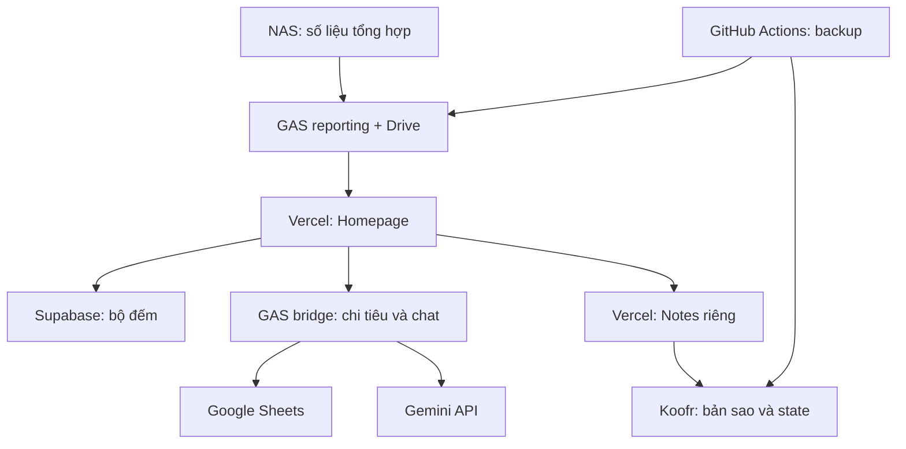

# Vận hành Homepage — cửa vào hiện hành

Bổ sung ngày 27/10/2026, Asia/Ho_Chi_Minh. Runtime xác thực 26/10:
`737897f`, deployment `dpl_7uRsAYTHB3i578uiHMUYDMz9tqSD`; xem
[bằng chứng và giới hạn](SHARED-PASSWORD-DECISION-20261026.md). Chủ hệ thống xác nhận
mục nghiệm thu đăng nhập chung/thu hồi phiên OK ngày 27/10; không phải smoke test mới
do AI nhập mật khẩu thật. Snapshot alias 22/10 và inventory 19/10 bên dưới là lịch sử.

| Tính năng | Nguồn chi tiết và trạng thái bằng chứng |
| --- | --- |
| Báo cáo NAS | [GAS policy](NAS-REPORTS-EVENT-POLICY-20261018.md), [cutover](results/nas-gas-production-cutover-20261019.md); cần số đo NAS mới để kết luận hiện trạng host |
| Drive/Photos Daily | [Phục hồi hoàn tất 20/10](results/backup-report-recovery-20261020.md), [metrics](BACKUP-REPORTING.md); hai feed HTTP 200 tại mốc đó, source mặc định GAS |
| Photos tổng tiến độ | [Snapshot manifest chung](BACKFILL-PROGRESS-20261022.md): một mục với Đã upload và Còn cần upload (chờ + lỗi); giữ thời điểm chốt, không cộng số lượt Daily/Backfill |
| QR | [Kích hoạt Koofr 21/10](QR-KOOFR-COMPLETE-20261021.md); không nhập lại hoặc dùng Blob override cũ làm nguồn mới |
| Notes | [Release Notes chuyên trách](https://github.com/hunghvt-cyber/Hunghvt-notes/blob/release/minimal-notes/docs/RELEASE.md); API Homepage cũ 410 |
| Chi tiêu/Gemini | [Chat](GEMINI-CHAT-20261020.md), [trạng thái 21/10](QR-RESUME-20261021.md); GAS bridge khác reporting/webhook |
| Đăng nhập | [Mật khẩu chung Homepage–Notes, owner accepted 27/10](SHARED-PASSWORD-DECISION-20261026.md), [quản lý mật khẩu](HOMEPAGE-ACCESS-20261026.md); cookies riêng, chưa SSO. [Bộ đếm](LOGIN-LIMITER-SUPABASE-20261019.md); SQL source và function DB `homepage_login.consume_attempt` cùng 5/IP, 30 tổng/900 giây; đã truy vấn metadata chỉ đọc 22/10, không gọi RPC hoặc đọc/sửa state |

Nguồn máy đọc [data-sources.json](data-sources.json) chứa snapshot theo ngày và
latest_status_override; không lấy riêng trường NO_REPORT cũ rồi mở lại việc đã xong.
Bản đồ cấp hệ thống thuộc [NAS AIO](https://github.com/hunghvt-cyber/0219nas-aio).

## Bổ sung NAS ngày 27/10

Theo output host do chủ hệ thống cung cấp, công cụ Node/npm/Python đã chuyển sang
HDD và giữ đường dẫn cũ bằng symlink; root giảm 81% → 74%, trống khoảng 1,6G.
Publisher user service có gate mountpoint cho /vol1; chưa kiểm cloud ACK sau chuyển
hoặc reboot. Không coi bản snapshot trước chuyển là nghiệm thu publisher mới.
Chi tiết ở [hồ sơ storage NAS](https://github.com/hunghvt-cyber/0219nas-aio/blob/main/NAS-STORAGE-20261027.md); retention bị ngắt/chặn là việc riêng
ở [repo Tapo](https://github.com/hunghvt-cyber/tapo-nas-lab/blob/main/docs/CURRENT-OPERATIONS.md).

## Thứ tự đối chiếu và giới hạn

Đọc entry này → hồ sơ tính năng → source/config → bằng chứng runtime mới nếu cần.
Các snapshot phía dưới được giữ làm bằng chứng; thông số, hạn chế và lần kiểm tra
phải giữ đúng ngày. Không dùng CI fixture hoặc READY để chứng nhận dữ liệu thật.
Không đổi secret/backend, chạy lại initialization/migration/backup hay deploy chỉ để đồng bộ tài liệu.

## Snapshot vận hành 19/10 và bổ sung 20–22/10 — lưu lịch sử

> Backfill 22/10: [thẻ tiến độ riêng](BACKFILL-PROGRESS-20261022.md) đọc snapshot tổng hợp từ nhánh GitHub `reports/backfill`, tách với trạng thái lượt đang chạy. Hai feed Daily/Drive vẫn dùng GAS; các bảng lịch sử phía dưới không bao gồm nguồn mới này.

> QR hoàn tất 21/10/2026: [Koofr guide đã kích hoạt](QR-KOOFR-COMPLETE-20261021.md). Chủ hệ thống chấp nhận sáu bản nền; đã nhập, readback và lưu/mở lại thành công. Các ghi chú chờ phía dưới thuộc snapshot cũ, không mở lại việc này.

# Hồ sơ quản trị và vận hành Homepage

Chat Gemini 20/10: [chọn model và nội dung dài](GEMINI-CHAT-20261020.md).
Giới hạn mới 50.000/tin, 200.000 lịch sử, 20 lượt; cần rollout GAS rồi Homepage.

Cập nhật: 19/10/2026, Asia/Ho_Chi_Minh. Đối chiếu code Homepage `ccb4fb2`,
Vercel production/env metadata, Supabase và HTTP public. Lần đọc mới:
**13:26 giờ Việt Nam**. Đây là snapshot có thời điểm, không phải trang giám sát tự động.

Nguồn tra cứu máy đọc: [data-sources.json](data-sources.json).
Bằng chứng: [operations-20261019.json](results/operations-20261019.json).
Tài liệu này thay phần mô tả “hiện tại” trong các hướng dẫn cũ khi có mâu thuẫn;
không xóa bằng chứng lịch sử.

## 1. Sáu nhóm hạ tầng

| Nhóm | Nguồn thật/đối tượng quản lý | Không được hiểu nhầm |
| --- | --- | --- |
| NAS | Cache collector và kết quả bảo trì/retention có sẵn; publisher gửi số liệu tổng hợp | Homepage không điều khiển recorder; xem được snapshot không chứng minh camera đang hoạt động ngay lúc đọc |
| GitHub | Source, tài liệu, lịch sử thay đổi; Actions chạy backup độc lập | Commit/push không xác nhận runtime Google/NAS đã cập nhật |
| Vercel | Build/host Homepage, API server, cookie; project Notes riêng; Blob là sản phẩm con | Blob không còn là nguồn báo cáo được chọn và không còn là nơi dùng Notes mới |
| Supabase | Project CongchungVND, schema homepage_login cho bộ đếm | Chia sẻ project với ôn thi; không được sửa dữ liệu/quyền ôn thi |
| Google | GAS reporting + Drive; GAS bridge + Sheets/Gemini; GAS webhook riêng; Photos là nguồn media | Chung hệ sinh thái không có nghĩa chung deployment, key hay trạng thái |
| Koofr | Notes riêng; backup Drive/Photos và state của backup | Hai báo cáo JSON trên GAS không thay thế media hoặc state ở Koofr |

Phụ thuộc theo tính năng: Telegram cấp giao dịch cho bot; Tailscale cần khi mở
Viewer/FnNAS từ ngoài LAN; Gemini API cần cho chat. Home-AI/Firestore là hệ riêng,
Homepage chỉ chứa link. Không cộng một shortcut thành database của Homepage.

## 2. Bản đồ dữ liệu

| Dữ liệu/tính năng | Nguồn chuẩn | Đường đi tới giao diện | Ghi ở đâu |
| --- | --- | --- | --- |
| Tiêu đề, shortcut, hướng dẫn nền, ảnh, QR | GitHub content/ và public/images/ | Build → Vercel dist | Sửa repo → main → build |
| Sửa hướng dẫn trên web, lịch sử guide | Koofr namespace Homepage-Guides riêng (đã kích hoạt 21/10) | /api/guides + guide nền | Vercel API kiểm phiên/origin/revision, DAV lock/readback rồi ghi Koofr |
| Camera, dung lượng, RAM/swap, bảo trì, dọn video | Cache/kết quả job NAS; Drive giữ báo cáo đã commit | NAS publisher → GAS reporting → Drive → /api/nas-report → UI | NAS gửi HMAC; GAS commit immutable file + HEAD |
| Báo cáo Drive ↔ Koofr | Kết quả workflow bisync | Actions → GAS reporting/Drive → /api/backup-report?source=gdrive | Publisher ở repo backup |
| Báo cáo Photos → Koofr | Kết quả workflow daily | Actions → GAS reporting/Drive → /api/backup-report?source=gphotos | Publisher ở repo Photos; backfill/reconcile không xuất feed này |
| Bộ đếm đăng nhập | Supabase homepage_login.state | Vercel auth → RPC Supabase → kiểm mật khẩu → cookie | Giao dịch PostgreSQL; không lưu mật khẩu/IP thô |
| Phiên/mật khẩu Homepage | Vercel env + cookie mã hóa tại máy người dùng | GET/POST /api/auth | Vercel cấp/hủy cookie; session GET/logout không tăng bộ đếm |
| Notes mới, folder, checklist, ACL/history | Koofr trong namespace Notes riêng | /notes/ → hunghvt-notes.vercel.app → API Notes → WebDAV Koofr | Notes project riêng; nháp IndexedDB chưa phải backup |
| Chi tiêu/thu nhập | Google Sheets của bot hiện hành | Homepage /api/expenses → GAS action homepage_stats → Sheets | Bot webhook doPost ghi Sheets; Homepage thống kê chỉ đọc |
| Chat Gemini | GAS bridge gọi Gemini API | /api/chat → GAS action homepage_chat → Gemini | Không coi câu model tự giới thiệu là bằng chứng model đang cấu hình |

Mũi tên Homepage → Notes là chuyển sang ứng dụng độc lập, không phải server
Homepage trực tiếp đọc kho Notes. GitHub source/build và guide Koofr
được mô tả trong bảng để sơ đồ tập trung vào luồng dữ liệu runtime.

## 3. Định danh source và nơi triển khai

| Thành phần | Repo/nhánh chuẩn | Nơi triển khai/trạng thái đối chiếu |
| --- | --- | --- |
| Homepage | hunghvt-cyber/Homepage-nas, main | https://homepage-nas.vercel.app/ ; Vercel homepage-nas, prj_3CCmGVbfaymDVoO66d6MPU1CQ1nw |
| Notes | hunghvt-cyber/Hunghvt-notes, release/minimal-notes | https://hunghvt-notes.vercel.app/ ; project prj_c4sEp6nB4msWTsPiGoALSuVutVTK ; latest READY source 85f01a6 |
| NAS publisher | Homepage-nas scripts/publish_status.py + nas_report_policy.py + nas_report_transport.py | NAS operator evidence cho checkout 2be7d18; chưa SSH đối chiếu lại trong đợt lập tài liệu này |
| Recorder/Viewer | hunghvt-cyber/tapo-nas-lab | Vận hành trên NAS; không sửa khi làm báo cáo Homepage |
| Reporting GAS | Homepage-nas reporting/apps-script/ + reporting/*-schema.cjs | Deployment URL lấy NAS_REPORT_GAS_URL/BACKUP_REPORT_GAS_URL; hiện cùng endpoint |
| Drive ↔ Koofr | hunghvt-cyber/my-backup-gdrive-koofr, main; .github/workflows/bisync.yml | GitHub-hosted Actions; source đã có lựa chọn gas-drive/blob |
| Photos → Koofr | hunghvt-cyber/google-photos-koofr, main; .github/workflows/daily.yml | GitHub-hosted Actions; source đã có lựa chọn gas-drive/blob |
| Chi tiêu/Gemini bridge | hunghvt-cyber/poorman-telebot main, bridge HTTP legacy được giữ | Vercel EXPENSES_API_URL chỉ đúng GAS bridge; không dùng nó để suy ra webhook bot |
| Bot chi tiêu hiện hành | poorman-telebot, experiment/gas-webhook-isolated:experiments/gas-webhook/ | @PoormanTest0219_bot, GAS webhook riêng; đọc PROJECT_CONTEXT.md đầu file |
| Bộ đếm | Homepage-nas lib/login-limit*.js + deploy/supabase/homepage-login-limiter.sql | Supabase CongchungVND, ref sxnuwfnqgqjrjvoosjep, region ap-southeast-1; org Free |
| DR NAS | hunghvt-cyber/0219nas-aio | Tài liệu khôi phục; không phải ứng dụng Homepage hay job backup tự chạy |

Vercel team đang quản lý: hunghvt, ID team_gCsQcRiaCja0GafKj8JZLINI.
Homepage Supabase rollout: commit ccb4fb264a4292a63b7ac12ad9f2f554474cfbb9,
deployment dpl_12x4TdUfaSufN1TFxGyBnihf5Zvp.
Notes latest deployment đã đọc: dpl_97WThiMJ427dyDB2ajMHYLgDQjVP.
Repo Notes main gần như trống; không tự merge/redeploy từ main để “sửa tài liệu”.

## 4. Cấu hình hiện hành và nơi giữ key

Chỉ ghi tên, target và vai trò; không lưu giá trị secret trong tài liệu/log/chat.

| Nơi giữ | Tên cấu hình | Vai trò |
| --- | --- | --- |
| Vercel Homepage production | NAS_REPORT_STATUS_URL=/api/nas-report | Chọn nguồn NAS khi build |
| Vercel Homepage production | NAS_REPORT_GAS_URL | URL reporting GAS, không phải secret |
| Vercel Homepage production | BACKUP_REPORTS_API_URL=/api/backup-report ; BACKUP_REPORT_GAS_URL | Chọn hai báo cáo GAS |
| Vercel Homepage production | LOGIN_LIMIT_BACKEND=supabase ; LOGIN_LIMIT_SUPABASE_URL | Chọn bộ đếm và project |
| Vercel Homepage production Secret | LOGIN_LIMIT_SUPABASE_KEY ; LOGIN_LIMIT_TOKEN | Publishable API key + machine token giới hạn riêng; không dùng service_role |
| Vercel Homepage production Secret | PORTAL_PASSWORD ; SESSION_PASSWORD ; PORTAL_BASE_URL | Mật khẩu chung, mã hóa phiên và origin |
| Vercel Homepage production Secret | PORTAL_PRIVATE_BLOB_TOKEN | Chỉ giữ phục hồi/đối chiếu dữ liệu cũ; runtime mới không đọc token này |
| Vercel Homepage production | EXPENSES_API_URL + Secret EXPENSES_API_SECRET | GAS bridge ký HMAC cho thống kê và Gemini |
| NAS config owner-only 0600 | URL, key, generation | Khóa gửi NAS riêng; vị trí thực theo service/config NAS đã xác minh |
| GAS reporting Script Properties | NAS_REPORT_KEY/FOLDER/HEAD/LOG ; BACKUP_GDRIVE_KEY/FOLDER/HEAD/LOG ; BACKUP_GPHOTOS_KEY/FOLDER/HEAD/LOG | Tách key/state mỗi nguồn; cùng ScriptLock và quota tài khoản |
| Repo backup Actions | Variable REPORT_BACKEND=gas-drive, REPORT_GAS_URL ; Secret REPORT_GAS_KEY | Mức cấu hình cần có để phát báo cáo GAS; giá trị variable thực tế chưa đọc được trong đợt này |
| Repo backup Actions | BLOB_READ_WRITE_TOKEN | Cấu hình publisher Blob cũ, không được coi là feed đang hoạt động |
| Vercel Notes production Secret | KOOFR_NOTES_USER ; KOOFR_NOTES_APP_PASSWORD ; NOTES_PASSWORD ; NOTES_SESSION_PASSWORD | Credential riêng cho Notes, không sao chép rclone/backup secret |
| Vercel Notes production | NOTES_MODE ; NOTES_PROJECT_ID ; NOTES_DATA_NAMESPACE ; NOTES_BASE_URL | Ràng buộc project/namespace/origin riêng |
| GAS bot/bridge Script Properties | Khóa Telegram/Gemini, spreadsheet ID, khóa HMAC và cấu hình riêng từng project | Không lấy key của reporting thay key bot hoặc ngược lại |

Nguồn mặc định NAS/backup đã là API GAS/Drive; không còn URL hoặc nhánh dự phòng Blob trong build/trình duyệt.
Preview không có đầy đủ secret production; không đồng bộ chúng sang Preview để
né lỗi cấu hình. Secret/key scopes phải được review khi đổi backend.

## 5. Chu kỳ chạy và ý nghĩa thời gian

- NAS: timer cũ kiểm tra 5 phút; policy chỉ gửi khi có thay đổi đáng kể hoặc
  heartbeat 30 phút. Tick bị bỏ qua không tăng sequence. Không hiểu thành “GAS
  phải có bản ghi mới mỗi 5 phút”. Không reset pending/generation/sequence để chữa lỗi.
- Homepage làm mới nhóm camera/NAS mỗi 5 phút. UI GAS xét received_at quá 45 phút
  hoặc phép đo đã cũ >15 phút tại lúc nhận; adapter timeout 12 giây, UI NAS 15 giây.
- updated_at là thời gian phép đo NAS; _report.received_at là lúc GAS nhận.
  Maintenance/retention giữ measured_at của lượt job thực, không thay bằng thời gian mở trang.
- Drive bisync: cron 19:00 UTC, dự kiến 02:00 Việt Nam hôm sau.
- Photos daily: cron 20:17 UTC, dự kiến 03:17 Việt Nam hôm sau.
- Photos backfill: 21:45 UTC CN/T3/T5/T7 → 04:45 Việt Nam T2/T4/T6/CN.
- Photos quarterly reconcile: 19:41 UTC ngày 1 tháng 1/4/7/10 → 02:41 Việt Nam
  ngày 2. V1 chỉ lập báo cáo, không xóa. Backfill/reconcile không đẩy feed daily.
- Lịch GitHub có thể trễ; đọc thời gian run thật. Backup engine outcome và kết quả
  publish báo cáo phải được kiểm tra riêng.

## 6. Những gì đã xác minh và phần còn thiếu

| Hạng mục | Bằng chứng hiện tại | Giới hạn |
| --- | --- | --- |
| NAS feed | 13:26 VN: GET /api/nas-report HTTP 200; đo 13:01:21, GAS nhận 13:01:37.917, recovered_previous=false | Không SSH kiểm lại service hoặc tạo lỗi mạng/camera |
| Backup gdrive/gphotos | Cả hai HTTP 503 với code NO_REPORT lúc 13:26 VN | Đã chọn/deploy adapter, chưa có báo cáo terminal thật để xác nhận đường publish |
| Workflow Drive | Run 39166849940, 19/10 04:13:11 VN, failure | Job không có steps/log URL từ API đã đọc; chưa kết luận nguyên nhân lỗi mới |
| Workflow Photos daily | Run 39172293967, 19/10 05:27:19 VN, failure | Không kết luận backup đã chạy hay dữ liệu Koofr mới |
| Supabase limiter | RPC/permission checks; concurrent 8/IP chỉ 5 được phép; tổng chỉ 30; reset window; production auth đã đi tới kiểm mật khẩu và DB tăng bộ đếm | Không đọc mật khẩu thật; phiên cookie được test local, người dùng nhập mật khẩu cũ |
| Notes | Vercel READY từ đúng nhánh; env Koofr riêng; Homepage /notes/ mở app riêng; legacy API 410 | Không đọc nội dung Notes thật hoặc kiểm lại CRUD Koofr trong đợt tài liệu này |
| Guides | Adapter Koofr đã có; public đọc bản nền khi kho chưa sẵn sàng | Chưa có credential guide, chưa lấy được overrides Blob; lưu bị khóa tới khi import/đối chiếu |
| Chi tiêu/Gemini | Source API + env bridge tồn tại | Chưa gọi tính năng bằng phiên người dùng trong đợt tài liệu này; chưa đọc model runtime |
| Blob | URL mặc định/secret cũ còn tồn tại; không còn được chọn cho reports/login | Mốc 14/11/2026 là thông báo quota được ghi nhận trước, chưa kiểm lại dashboard; không cam kết Blob hoạt động ngày đó |

Hai repo backup hiện được GitHub liệt kê là public. Những tài liệu cũ nói
“private Actions bị chặn billing” là bối cảnh lịch sử; run mới vẫn failure nhưng
chưa có bằng chứng để quy cùng nguyên nhân. Không đổi visibility hoặc chạy lại
engine trong một đợt cập nhật tài liệu.

## 7. Quy trình cập nhật

1. Đọc hồ sơ này, JSON nguồn, AGENTS.md và tài liệu tính năng; xác minh đúng repo,
   nhánh, project, target và HEAD. Ưu tiên cấu hình production + phản hồi thực tế,
   không dùng riêng status_url trong site.json hay đoạn lịch sử ở cuối handoff.
2. Sửa riêng phần được giao. Chạy test phù hợp; source runtime cần build, JS syntax,
   link/asset nội bộ. Commit không có credentials/private snapshot.
3. Homepage main → Vercel build/deploy tự động. Kiểm source SHA, READY, alias
   production và API/luồng người dùng. Quay lại code không tự quay lại dữ liệu.
4. GAS reporting là một deployment Google khác: đổi GitHub source không tự sửa GAS.
   Khi triển khai phải đủ Core/Server/BackupSchema/Backup và manifest tương ứng;
   giữ URL/keys/HEAD. Updater của Notes prototype cũ không được chạy nguyên trạng.
5. NAS: operator áp dụng publisher/config đã review dưới đúng user/timer cũ.
   Không dùng sửa báo cáo để thay recorder/collector/retention hoặc tạo job nền mới.
6. Backup engines ở hai repo riêng. Thay report transport không đồng nghĩa sửa
   rclone/manifest/profile/checkpoint. Giữ kết quả backup và lỗi report tách biệt.
7. Mọi thay đổi nguồn phải cập nhật OPERATIONS.md + data-sources.json và bằng chứng
   có giờ kiểm tra. Không tuyên bố hoàn tất chỉ từ test mô phỏng.

## 8. Tra lỗi theo điểm đứt

| Triệu chứng | Kiểm tra đầu tiên | Cách xử lý đúng phạm vi |
| --- | --- | --- |
| Không mở khóa, 503 | LOGIN_LIMIT_BACKEND, cấu hình Supabase, RPC/status/pause | Giữ fail-closed; không bỏ limiter hoặc tự fallback sang Blob |
| 429 khi nhập mật khẩu | 5/IP, 30/global, khung 15 phút | Chờ hết khung; không reset bộ đếm production để né giới hạn |
| NAS dữ liệu cũ/502 | received_at so với updated_at; API → GAS; pending/ack NAS | Xác định collector, publisher hay read adapter lỗi; không suy camera hỏng từ lỗi feed |
| Backup NO_REPORT | Latest run/job + bước publish + key/source đúng | Sửa/kiểm chứng publisher riêng khi được giao; không tạo báo cáo giả |
| Note mất/không lưu | Đang ở hunghvt-notes hay trang cũ; Koofr app/namespace/IDB | Không khởi động lại Notes Blob; export nháp trước, tránh ghi đè catalog |
| Sửa guide lỗi lưu trữ | KOOFR_GUIDES_* và revision/lock/readback | Giữ bản đang nhập; đọc QR bằng bản nền có cảnh báo; không tự tạo dữ liệu đè nguồn cũ |
| Chi tiêu sai/lỗi | GAS bridge, spreadsheet đang dùng, quy tắc Date/DELETED | Không đổi Sheet hoặc sửa giao dịch theo suy đoán |
| Gemini tự nói tên model lạ | Model cấu hình trong GAS và request Gemini thực | Câu trả lời tự giới thiệu không chứng minh model |
| Viewer/FnNAS không vào | Tailscale/shortcut và NAS | Là link riêng; không đổi Vercel/GAS để sửa mạng NAS |

## 9. Dự phòng, backup và ranh giới

- Homepage không còn SDK hoặc đường chạy Vercel Blob. Giữ nguyên object/secret Blob cũ chỉ để phục hồi/đối chiếu guide; chưa xóa dữ liệu hay ngắt integration.
- Bộ đếm dùng Supabase lâu dài theo chỉ đạo mới nhất; không có nhánh hoặc lịch quay về Blob.
- Guide Koofr dùng credential/namespace riêng, không dùng mật khẩu hoặc namespace Notes/backup. KOOFR_GUIDES_READY chỉ bật sau xác minh đủ sáu guide. [Quy trình chuyển](QR-KOOFR-20261019.md).
- Notes Blob đã nghỉ; bằng chứng cleanup cũ ghi xóa 27 object (25 note, 1 share,
  1 index). Không coi store đó là bản dữ liệu Notes mới để rollback. Không dọn thêm.
- Notes Koofr có export snapshot; tài liệu release chưa có backup độc lập tự động.
  Khôi phục sang root mới và đối chiếu hash/IDs trước khi đổi namespace; không PUT
  tay vào catalog production. Nháp IndexedDB có thể bị trình duyệt xóa.
- Supabase org Free đã xác minh; ít hoạt động có thể pause. Bảng bộ đếm không
  chứa dữ liệu kinh doanh cần giữ dài hạn; ôn thi là dữ liệu khác, không xóa chung.
- GAS các nguồn dùng key/HEAD riêng nhưng chung quota Google/ScriptLock trong
  project reporting; không thể hứa miễn nhiễm quota hoặc khóa tài khoản.
- Guide nền/source có Git; guide overrides/history Koofr vẫn cần export/backup riêng.
- Drive bisync là hai chiều, không coi là bản sao bất biến. Photos là một chiều;
  state Koofr quan trọng cho phục hồi runner. Không resync/reset/purge trong đợt này.

## 10. Các nguồn để AI kiểm tra tiếp

- [Supabase limiter](LOGIN-LIMITER-SUPABASE-20261019.md)
- [Notes retirement](NOTES-RETIREMENT-20261018.md)
- [Blob còn phụ thuộc gì](BLOB-DEPENDENCIES-20261018.md)
- [NAS recovery evidence](results/nas-publisher-recovery-20261019.md)
- [Mã Notes đang phát hành](https://github.com/hunghvt-cyber/Hunghvt-notes/tree/release/minimal-notes)
- [Notes release, đọc các cập nhật mới nhất](https://github.com/hunghvt-cyber/Hunghvt-notes/blob/release/minimal-notes/docs/RELEASE.md)
- [Bot webhook hiện hành, đọc phần đầu](https://github.com/hunghvt-cyber/poorman-telebot/blob/experiment/gas-webhook-isolated/experiments/gas-webhook/PROJECT_CONTEXT.md)
- [Drive workflow](https://github.com/hunghvt-cyber/my-backup-gdrive-koofr/blob/main/.github/workflows/bisync.yml)
- [Photos daily workflow](https://github.com/hunghvt-cyber/google-photos-koofr/blob/main/.github/workflows/daily.yml)

Việc cần xác minh tiếp: (1) nguyên nhân hai workflow failure và báo cáo GAS đầu
tiên của từng nguồn; (2) hướng xử lý guide overrides còn ở Blob; (3) backup định kỳ
Notes cùng thủ tục khôi phục. Đây là backlog, không tự tạo lịch hay thay production.

